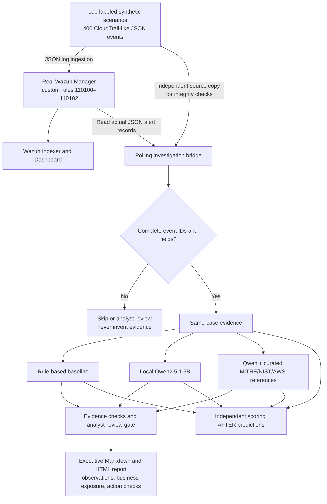
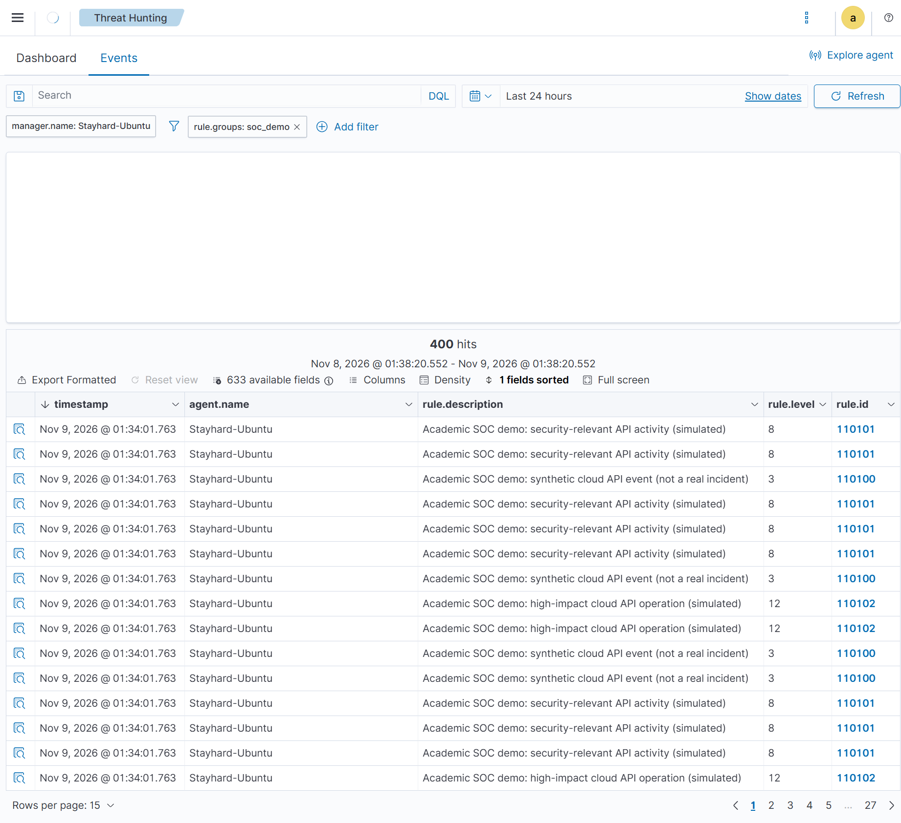
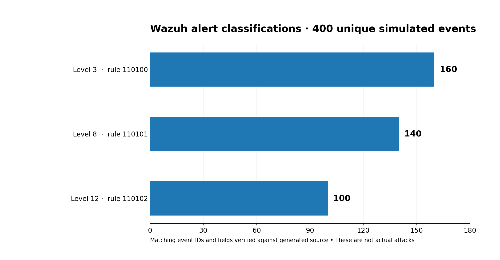
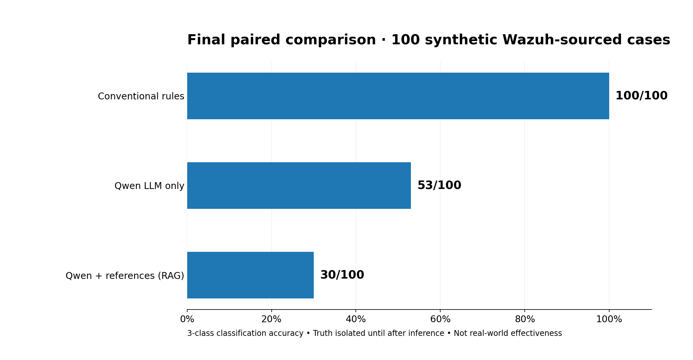
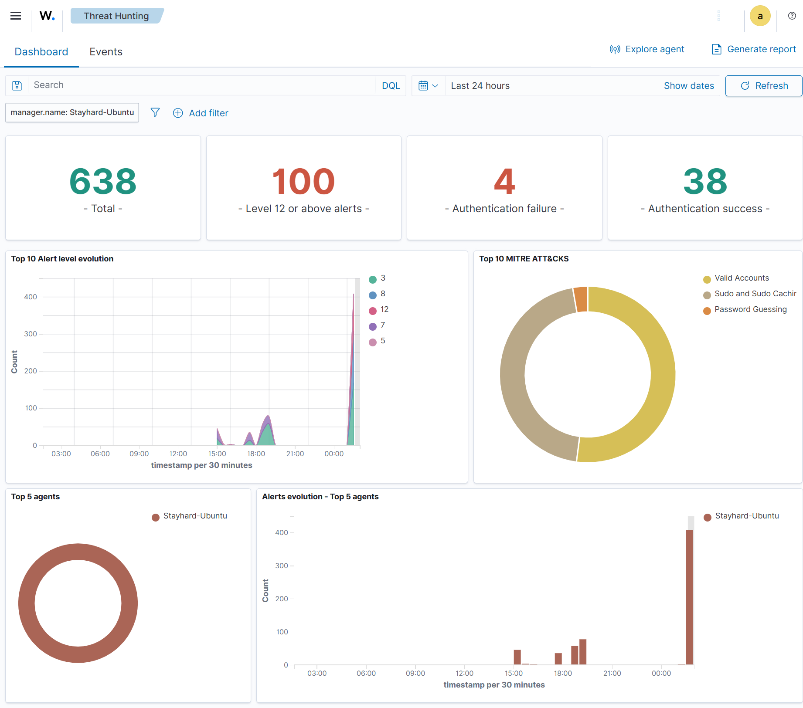

# Evaluating AI-Assisted Cloud Security Incident Response

**Lakehead University · COMP 5112 Research Methodology · Academic research paper (November 2026)**

[](https://www.python.org/) [](https://wazuh.com/) [](https://ollama.com/) [](#research-design-and-data)

> **At a glance:** An evidence-verifiable, human-supervised research workflow links actual **Wazuh SIEM alert records** to a rule-based investigator, an unmodified local LLM, and a reference-assisted LLM. The project generates a business-readable executive report while keeping unsupported model assertions separate from verified observations. **No actual AWS attack or autonomous remediation is performed.**

**Start here:** [Reproduce from a fresh VMware Ubuntu VM](docs/SETUP_FROM_SCRATCH.md) · [Research journey & limitations](docs/RESEARCH_JOURNEY_AND_LIMITATIONS.md) · [Final 100-case results](docs/wazuh_ai_final_results.md) · [Demo runbook](docs/wazuh_ai_completion_runbook.md)

---

## 1. Research problem

Cloud-security logs show API calls and identities, but individual alerts do not explain intent, verified impact, or business significance. Analysts must correlate evidence, assess severity, and communicate actionable findings. A language model might help with interpretation—but it can also misclassify incidents or invent unsupported explanations.

**Research question:** *How do conventional rules, a local LLM, and retrieval-augmented generation compare for controlled cloud-security incident investigation, and can evidence checks make AI-generated reporting safer?*

**What this project tests:** classification accuracy, output reliability, citation/claim quality, processing time, and analyst-review demand as a **proxy**. It does **not** claim real human time savings or real-world threat-detection accuracy.

## 2. System architecture



The *same verified Wazuh events* are used for each of the three investigators. The AI prompt excludes synthetic ground-truth labels and Wazuh rule severity. The bridge is a **file-polling prototype**, not a dashboard click integration or production streaming service.

## 3. Technology and design choices

| Layer | Technology | What it does |
|---|---|---|
| Host / lab | Windows + VMware Workstation + Ubuntu Linux | Isolated local test environment |
| SIEM | Wazuh 4.14.9 Manager, Indexer, Dashboard | Ingests tagged JSON and issues three alert levels |
| Investigation | Python 3, JSON/JSONL | Case matching, baseline classification, report generation |
| Local AI | Ollama + **pretrained** `qwen2.5:1.5b` | LLM-only and RAG-assisted assessments; **not fine-tuned** |
| Retrieval | Curated local MITRE ATT&CK / NIST / AWS reference notes | Supplies relevant background; not full-source semantic RAG |
| Evaluation | Private synthetic labels + Python `unittest` | Post-inference comparison; explicit failures and traceability |
| Documentation | Markdown, HTML, dashboards and charts | Research audit trail and business-focused report |

## 4. Research design and data

The final Wazuh-linked study uses **100 controlled cases** built from **10 scenario templates repeated 10 times**: 40 labeled benign, 30 suspicious and 30 designated critical. These become **400 generated JSON event records**. Labels are *simulation references*, not proof of actual adversarial activity.



*Actual Wazuh Threat Hunting screenshot, filter `rule.groups: soc_demo`. The 400 hits are simulated events, not 400 real attacks.*

Our custom rule matches on JSON action names and tags:

| Rule ID | Wazuh level | Examples | Unique event count |
|---|---:|---|---:|
| `110100` | 3 | Routine API inventory and generic cloud actions | 160 |
| `110101` | 8 | `GetObject`, `GetBucketAcl`, `ConsoleLogin` | 140 |
| `110102` | 12 | `DeleteTrail`, `StopLogging`, `CreateAccessKey`, `AttachUserPolicy`, `DeleteObject` | 100 |



An archival audit read **797 candidate alert records** (including 397 duplicate copies across current and rotated logs), verified **400 distinct event IDs / 400 expected**, found **zero evidence-field mismatches**, and recovered **all 100 complete cases**. The earlier 397/400 result came from reading only the current `alerts.json` file; it was resolved using the archives.

### Separate real-world-style development dataset

An **earlier, separate** research track used publicly released **Ariel Cyber CloudTrail data** for development and a small six-case paired pilot; raw archives contain approximately 4,216 development and 24,087 external-test records. **Do not combine** its binary attack-associated scores with the final three-class synthetic SOC results or claim the external archive was used for a completed final evaluation. See [dataset card](docs/dataset_card.md), [three-method CloudTrail pilot](docs/three_method_comparison.md), and [research timeline](docs/RESEARCH_JOURNEY_AND_LIMITATIONS.md).

## 5. Final controlled experiment — 100 cases



| Method | Correct / 100 | Accuracy | Interpretation |
|---|---:|---:|---|
| **Rule-based baseline** | 100 | **100%** | Rules closely match deliberately generated patterns; optimistic and not a production estimate |
| **Local LLM only** | 53 | **53%** | More misclassifications, including risk underrating |
| **RAG-assisted LLM** | 30 | **30%** | Mainly predicted `suspicious`; retrieval did not improve classification |

All three methods evaluated the **same complete cases**. The evidence-based review gate is a separate safety mechanism: **do not report its effectiveness as improved AI accuracy**. Output quality flags identify some incorrect interpretations, but passing automated checks does not validate all natural-language claims.

**Central finding:** Adding a small pretrained LLM, or giving it curated security reference context, did **not** improve classification on this deliberately constructed benchmark. This is a **negative comparative result**, not a deployment-ready measurement. Repeated templates, a matched deterministic baseline, and a limited on-device model constrain generalization.

See [the fully reported results](docs/wazuh_ai_final_results.md) for the detailed metrics and [experiment log](docs/experiment_log.md) for failures, corrections, and run provenance.

## 6. Trace an investigation: `SOCSIM-009`

Wazuh recorded three linked simulated IAM actions:

| Source evidence ID | API action | Wazuh rule |
|---|---|---|
| `SOCSIM-009-EVT-01` | `ListPolicies` | `110100` |
| `SOCSIM-009-EVT-02` | `CreateAccessKey` | `110102` |
| `SOCSIM-009-EVT-03` | `AttachUserPolicy` | `110102` |

The monitoring and investigation are separate processes connected through *verified Wazuh alert records*, case ID and event IDs. In the observed run, conventional rules classified this case **critical** while LLM-only and RAG classified it **suspicious**; a conservative review gate flagged the discrepancy. The report advises a human to verify IAM authorization, access key changes and policy history. **The simulated API names do not prove those operations succeeded.**

### Quick reproduction on an existing prepared VM

```bash
cd ~/Projects/ai-cloud-incident-response
python3 -m unittest discover -s tests -q
sudo python3 -m src.demo.wazuh_pipeline audit \
  --alerts /var/ossec/logs/alerts --out /tmp/soc-audit
sudo python3 -m src.demo.wazuh_pipeline watch \
  --alerts /var/ossec/logs/alerts --case SOCSIM-009 --once \
  --out /tmp/soc-new-investigation
sudo python3 -m src.demo.wazuh_pipeline evaluate \
  --out /tmp/soc-new-investigation
```

Pick a **fresh `--out` path**, or `watch` correctly uses its cached result. The generated `EXECUTIVE_REPORT_REVIEW_REQUIRED.html` must be reviewed by a human before use. **Do not rerun the full experiment or modify the source data during a live demonstration.**



*Dashboard context: simulated cloud alerts coexist with routine Linux security activity. These are different evidence sources.*

## 7. Executive output and safety boundaries

The generated HTML/Markdown report provides observed operations, potential business exposure, cited Wazuh-matched event IDs, model decisions, conservative automated claim flags, and recommended human checks. It intentionally does **not** promote raw AI narrative to a verified finding.

Important safeguards:

- Unverified or incomplete event records are **excluded**, not inferred.
- API actions are **observations**, not confirmed outcomes, breaches or damages.
- Risk-reducing AI judgments cannot silently override evidence-based priority review.
- Model failures/abstentions remain recorded; no fallback to benign.
- Recommendations require **analyst approval**; no autonomous AWS actions.

## 8. Repository map

| Path | Role |
|---|---|
| `src/demo/soc_demo.py` | Deterministic synthetic generator and earlier six-case demonstration |
| `src/demo/wazuh_pipeline.py` | Verified Wazuh alert reader, polling bridge, comparative evaluation |
| `src/demo/grounded_model.py` | Local Qwen prompt, constrained JSON and citation validation |
| `src/demo/executive_html.py` | Stakeholder-friendly HTML report rendering |
| `src/ingestion/` | Earlier synthetic, Linux and CloudTrail evidence preparation |
| `src/investigation/` | Research baseline / LLM / RAG implementations |
| `src/evaluation/` | Integrity verification, benchmarking and evaluation components |
| `data/knowledge_base/` | Curated security reference notes (tracked) |
| `deploy/wazuh/` | Wazuh manager monitoring helper and custom rules |
| `tests/` | Reproducible regression tests (140 passed in verified 9 Nov run) |
| `docs/` | Research methodology, reports, visuals, timeline and setup guide |
| `data/lab_evidence/` | **Private / Git-ignored** generated events, labels, logs and AI outputs |

### Documentation index

- **[From scratch: VMware → Ubuntu → Wazuh → Ollama → results](docs/SETUP_FROM_SCRATCH.md)**
- [Study journey, bugs, experiments and limitations](docs/RESEARCH_JOURNEY_AND_LIMITATIONS.md)
- [Final 100-case Wazuh research results](docs/wazuh_ai_final_results.md)
- [Wazuh-to-AI runbook](docs/wazuh_ai_completion_runbook.md)
- [Dataset descriptions and provenance](docs/dataset_card.md)
- [Development log](docs/development_log.md) · [Experiment log](docs/experiment_log.md)
- [Design decisions](docs/research_decisions.md) · [Architecture notes](docs/ai_architecture.md)
- [Prior CloudTrail three-method pilot](docs/three_method_comparison.md)
- [Repository inventory and cleanup audit](docs/REPOSITORY_AUDIT.md)
- [Quick Start — How to Run the Project](HOW_TO_RUN_PROJECT.md)
## 9. Reproducibility, ethics and privacy

All experiment outputs under `data/lab_evidence/` are intentionally untracked: another researcher **must regenerate and score their own runs**. Runtime and LLM decisions can differ by model, operating environment, seed and software versions. Do not commit Wazuh alert exports, credentials, passwords, private labels or unreviewed executive reports.

This project is a classroom **research prototype**, not an operational managed detection and response service. It does not claim successful attacks, verified compromise, real analyst time savings, statistically independent 100 scenarios, comprehensive MITRE/NIST coverage, fine-tuned models or autonomous remediation.

## 10. Conclusion

We successfully integrated a real Wazuh SIEM with a local, evidence-verified three-method AI investigation pipeline and stakeholder reporting. **400/400 simulated events and 100/100 cases were source verified**, and the research produced a clear negative result: under these test conditions, **rule-based triage beat both LLM-only and RAG-assisted classification**. The practical contribution is a transparent, traceable **human-supervised** workflow and a documented methodology for evaluating AI failure modes, not a claim that generative AI is better than deterministic security detection.

*Academic study: Lakehead University, COMP 5112 · November 2026.*
