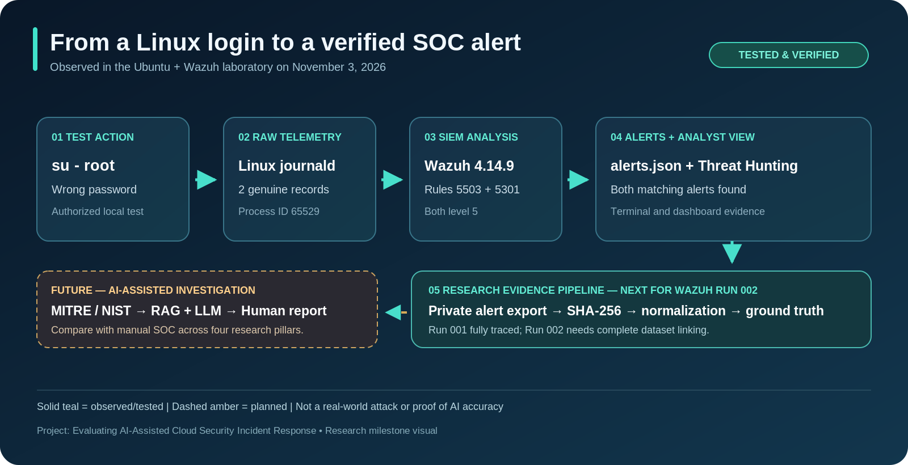
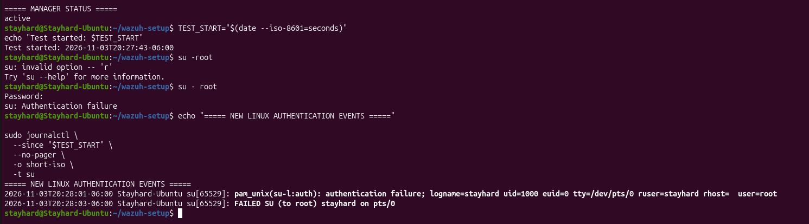
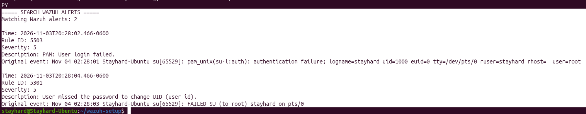
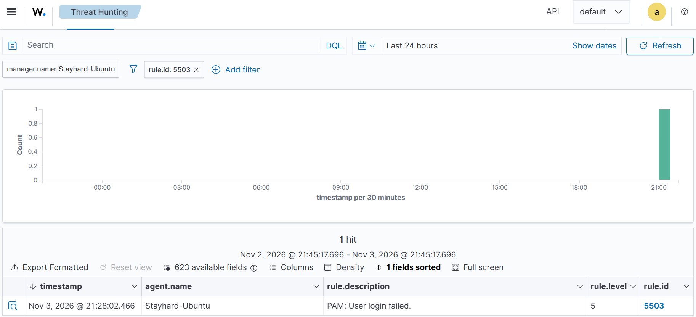
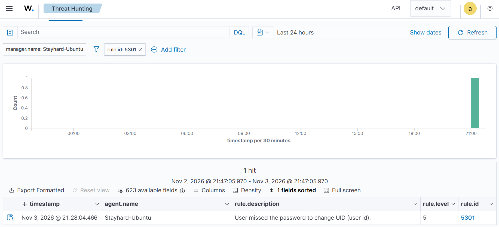
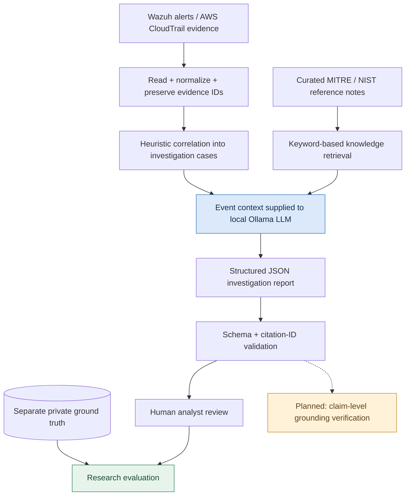

# Evaluating AI-Assisted Cloud Security Incident Response

**Subtitle:** Accuracy, Reliability, Explainability, and Analyst Efficiency

## Overview

This research project investigates how AI assistance affects cloud security
incident investigation compared with a baseline investigation workflow.

The project focuses on evidence-based investigation, transparent AI outputs,
human verification, and reproducible experiments.

## Research Objectives

- Evaluate investigation accuracy.
- Measure reliability and unsupported claims.
- Assess evidence grounding and explainability.
- Compare investigation time between baseline and AI-assisted workflows.
- Keep the human analyst responsible for final decisions.

## Proposed Architecture

1. Generate clearly labelled synthetic cloud audit events.
2. Collect security telemetry using Wazuh where compatible.
3. Process events and prepare evidence with Python.
4. Investigate incidents using a baseline workflow and a local AI-assisted workflow.
5. Compare results against independently defined ground truth.
6. Report findings using reproducible evaluation scripts and visualizations.

## Technology Direction

- Ubuntu Linux
- Python
- Git and GitHub
- Wazuh, subject to installation compatibility
- Local AI inference, subject to available hardware resources
- Grafana, as an optional visualization layer

The project prioritizes free, local tools and avoids requiring paid cloud services.

## Repository Structure

```text
data/
  raw/
  processed/
  ground_truth/
src/
  ingestion/
  investigation/
  evaluation/
experiments/
results/
docs/
```

## Dataset Notice

Initial datasets will contain synthetic events for research and testing.
They must not be represented as real cloud-provider logs.

## Research Integrity and Safety

- Preserve event evidence and record the source of each finding.
- Distinguish observed facts from hypotheses.
- Do not treat AI-generated conclusions as authoritative.
- Do not perform destructive remediation automatically.
- Never commit credentials, tokens, or sensitive real-world logs.

## Project Status

Initial repository and research dataset preparation.

The architecture and methodology may evolve as the literature review,
compatibility checks, and pilot experiments are completed.

## Visual SOC laboratory walkthrough



### Real monitoring demonstration (authorized local test)





| Wazuh rule 5503: failed PAM login | Wazuh rule 5301: failed user switch |
|---|---|
|  |  |

The observed local Ubuntu experiment generated two system-journal authentication entries which Wazuh 4.14.9 collected and matched to level-5 rules 5503 and 5301. Both alerts appeared in Threat Hunting. **This is an authorized local test, not a real adversary attack or completed LLM evaluation.**

[View all six original screenshots and provenance notes](docs/assets/README.md).

<!-- MILESTONE-2026-11-04-AI-CLOUD-START -->

---

## 🧠 AI-assisted cloud investigation | November 2026 milestone


> **Research objective:** Evaluate whether AI assistance improves the accuracy, reliability, explainability, and analyst efficiency of cloud-security incident investigations. This is a research prototype, **not** a production-grade SOC or an autonomous remediation system.

### Architecture: what runs today and what is still being built



**Architecture note:** The current CloudTrail case builder and Wazuh/RAG prototypes execute separately; the complete **CloudTrail case → LLM → evaluation** workflow is still being integrated. Arrows above describe the target research flow, not proof of end-to-end production readiness.


The [original SOC visual walkthrough](#visual-soc-laboratory-walkthrough) and six authentic lab screenshots are preserved. See [AI architecture and code walkthrough](docs/ai_architecture.md) for module responsibilities, inputs, limitations, and runnable commands.

### Evidence-backed engineering progress

| Capability | Latest verified evidence | State |
| :-- | :-- | :-- |
| Live Wazuh monitoring | Two `su` alerts (rules `5503`, `5301`) and dashboard screenshots | Verified |
| Evidence integrity and Wazuh normalization | SHA-256 checked; two normalized Wazuh events | Verified |
| Local LLM | Qwen2.5 1.5B inference through Ollama | Prototype executed |
| Retrieval-augmented inference | Keyword retrieval + LLM JSON reports | Prototype executed |
| Controlled LLM/RAG comparison | Same-prompt single-case exploratory run | Executed, **no accuracy claim** |
| CloudTrail development preprocessing | **4,216 events → 1,742 heuristic cases**, including 64 attack-associated cases and 4 mixed-label cases | Executed and checked |
| Held-out CloudTrail test-set audit | **24,087 events**, 2,585 attack-labeled / 21,502 benign, 10 scenario categories | Audited, **not benchmarked** |
| Python regression suite | **42 tests passing** at last execution | Existing suite passes; new modules need targeted tests |

**Key research finding so far:** Both controlled LLM-only and RAG variants marked a known authorized authentication preflight as `suspicious`; the controlled RAG report cited zero knowledge references despite retrieving them. Format-valid JSON and matching citation IDs **do not establish factual accuracy**. One `su` attempt produced two alerts; it is not evidence of two distinct attacks.

### Source code and demonstrations

| Component | Source | Current demonstration |
| :-- | :-- | :-- |
| Wazuh evidence normalization | [`normalize_wazuh_alerts.py`](src/ingestion/normalize_wazuh_alerts.py) | `python3 -m src.ingestion.normalize_wazuh_alerts` |
| Local LLM investigation | [`ai_investigator.py`](src/investigation/ai_investigator.py) | `python3 -m src.investigation.ai_investigator` |
| RAG investigation | [`rag_investigator.py`](src/investigation/rag_investigator.py) | `python3 -m src.investigation.rag_investigator` |
| Exploratory LLM/RAG comparison | [`compare_rag_conditions.py`](src/evaluation/compare_rag_conditions.py) | Single-case run already performed; private output not published |
| CloudTrail preprocessing | [`build_cloudtrail_cases.py`](src/ingestion/build_cloudtrail_cases.py) | `python3 -m src.ingestion.build_cloudtrail_cases` |
| Python regression tests | [`tests/`](tests/) | `python3 -m unittest discover -s tests` |

**Execution dependencies:** These are development commands, **not yet a one-click independent demo**. Ollama plus the locally downloaded `qwen2.5:1.5b` model is required for LLM runs. Evidence ZIPs and Wazuh JSONL records stay under the Git-ignored `data/lab_evidence/` directory and are not distributed publicly. A sanitized, self-contained professor demonstration and installation guide remain on the roadmap.

**Research navigation:** [Development log](docs/development_log.md) · [Experiment log](docs/experiment_log.md) · [Dataset card](docs/dataset_card.md) · [Research decisions](docs/research_decisions.md) · [Presentation/demo notes](docs/presentation_demo_notes.md) · [November 4 checkpoint](docs/checkpoints/2026-11-04_research_checkpoint.md)

<!-- MILESTONE-2026-11-04-AI-CLOUD-END -->

<!-- phase-98-reliability -->
## CloudTrail Reliability — November 5, 2026

**50/50 tests passing | 4,216 CloudTrail records | 1,742 investigation cases**

| Research metric | Verified result |
|---|---:|
| Attack-associated cases | 64 |
| Mixed-label cases | 4 |
| New reliability tests | 8 |
| Total automated tests | 50 |

### Cloud AI pipeline


**CloudTrail → Normalization → Case Correlation → AI/RAG Investigation → Evaluation**

The current correlation algorithm is experimental. Ground-truth labels are kept separate from AI input.

[AI Architecture](docs/ai_architecture.md) · [Experiment Log](docs/experiment_log.md) · [Development Log](docs/development_log.md)

<!-- phase-99-cloud-ai -->
## Phase 99 — CloudTrail AI Investigation

The first real CloudTrail development case was analyzed using
local Qwen2.5 1.5B and retrieved AWS security guidance.

**Pipeline:** CloudTrail case → evidence selection →
knowledge retrieval → Qwen → structured SOC report.

- 3 CloudTrail events analyzed.
- 32.03-second CPU inference.
- Report saved privately.
- 5 new tests passed.
- Citation IDs and report format validated.

**Research finding:** The model classified routine-looking
SSM activity as suspicious without sufficient supporting context.
Factual correctness remains unverified.

[Cloud AI source](src/investigation/cloud_case_investigator.py) |
[Cloud knowledge](data/knowledge_base/cloudtrail_guidance.json)

<!-- phase-100-verification -->
### Phase 100 — AI Evidence Verification

**66/66 tests passing.** An independent verifier now checks
AI report integrity, evidence citations, retrieved knowledge,
and selected factual overclaims.

First CloudTrail report: three review flags; manual review required.

[Verifier source](src/evaluation/verify_cloud_ai_report.py) |
[Verification tests](tests/test_cloud_ai_report_verifier.py)

This is targeted verification, not complete automated fact-checking.

<!-- cloud-evaluation-framework -->
## Cloud Investigation Evaluation

The evaluation framework compares investigation reports against
separately stored CloudTrail case-level ground truth.

- Development cases: 1,742
- Attack-associated cases: 64
- Mixed-label cases: 4
- Automated tests: 80 passing
- First AI report: one false positive against dataset labels

Only one AI report has been evaluated so far. No overall
accuracy or multi-method performance claims are established.

[Evaluation source](src/evaluation/evaluate_cloud_investigations.py) |
[Evaluation tests](tests/test_cloud_investigation_evaluation.py)
