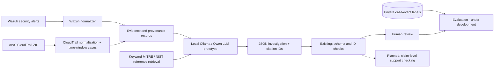

<!-- AI-ARCH-2026-11-04 -->
# Evidence-Grounded AI Investigation Architecture

*Research prototype reference — updated November 4, 2026*

> This document separates **verified functionality**, **experimental prototypes**, and **planned research work**. The project evaluates AI-assisted incident response; Wazuh is a telemetry source, not the AI.

## Architecture overview



**Important:** `build_cloudtrail_cases.py` does not yet feed its case outputs to the LLM. The graph is an intended system architecture assembled from separately verified components, not a demonstrated autonomous end-to-end deployment.

## Code responsibilities

| Python module | Core responsibility | Input → output | Status |
| :-- | :-- | :-- | :-- |
| `src/ingestion/normalize_linux_journal.py` | Parse original `su` journal export, validate and normalize | Linux journal → JSONL events | Verified with real preflight |
| `src/ingestion/normalize_wazuh_alerts.py` | Read archived Wazuh alerts, verify known-run hash, normalize | Wazuh JSONL → JSONL events | Verified on run 002; currently run-specific |
| `src/investigation/ai_investigator.py` | Build prompt, run Ollama API, schema/ID-check response | Wazuh events → JSON report | Prototype executed |
| `src/investigation/rag_investigator.py` | Tokenize, retrieve notes, invoke LLM with references | Events + notes → JSON report | Keyword RAG prototype executed |
| `src/evaluation/compare_rag_conditions.py` | Compare same-prompt runs with/without retrieved docs | One Wazuh case → private comparison | Executed once; non-blind |
| `src/ingestion/build_cloudtrail_cases.py` | Normalize event fields and group actor/IP/time bins, separate labels | Training ZIP → private case and truth JSONL | Executed on 4,216 records |

## Explain it to the professor

**`normalize(record, index)` (CloudTrail):** Extracts timestamps, actor identifiers, source IP, AWS service/action and limited context, then returns an event and a grouping key. It intentionally does not copy source `should_sample`/`attack_name` labels into AI evidence.

**`retrieve_references(events, documents, top_k)` (RAG):** Tokenizes event-action descriptions and document summaries; ranks by lexical overlap. This is deterministic retrieval, not embedding-based semantic search; a matching document is background knowledge, not proof of attack.

**`investigate(events)` or `investigate_with_rag(...)` (AI):** Selects event fields, constructs a system/user prompt, sends a JSON request to local Ollama, parses a model-generated report, validates schema and known citation IDs. This proves interface execution, *not* factual trustworthiness or a trained custom model. Qwen2.5 1.5B is a downloaded pretrained model used for inference, not a model trained by this project.

**`main()` (case builder):** Reads the training ZIP, normalizes every record, groups by `(actor, source_ip, 30-minute bin)`, writes the separate private label files, and checks for a direct label leak. Case grouping is a heuristic and can combine unrelated events.

## Measurable research limitations

- The authorized `su` preflight has been repeatedly labeled `suspicious` by LLM variants. This remains a preserved error case.
- The controlled RAG investigation returned no knowledge IDs despite retrieval. Citation membership is not citation *support*.
- Evaluation must keep case-level and event-level metrics distinct; no comprehensive score has been computed yet.
- Existing 42 regression tests cover earlier pipeline functionality; these new AI/CloudTrail modules need dedicated unit/integration tests.
- Source datasets and private results remain Git-ignored; the public repo does not currently include a clean-machine standalone demo.

## Local developer execution (requires configured lab)

```bash
python3 -m unittest discover -s tests
python3 -m src.ingestion.build_cloudtrail_cases
python3 -m src.investigation.ai_investigator
python3 -m src.investigation.rag_investigator
```

**Next architecture gates:** robust correlation; provenance-aware citation validation; guarded abstention; controlled cloud case evaluation; sanitized reproducible demo; documented exact dependency/model versions and latency measurements.
