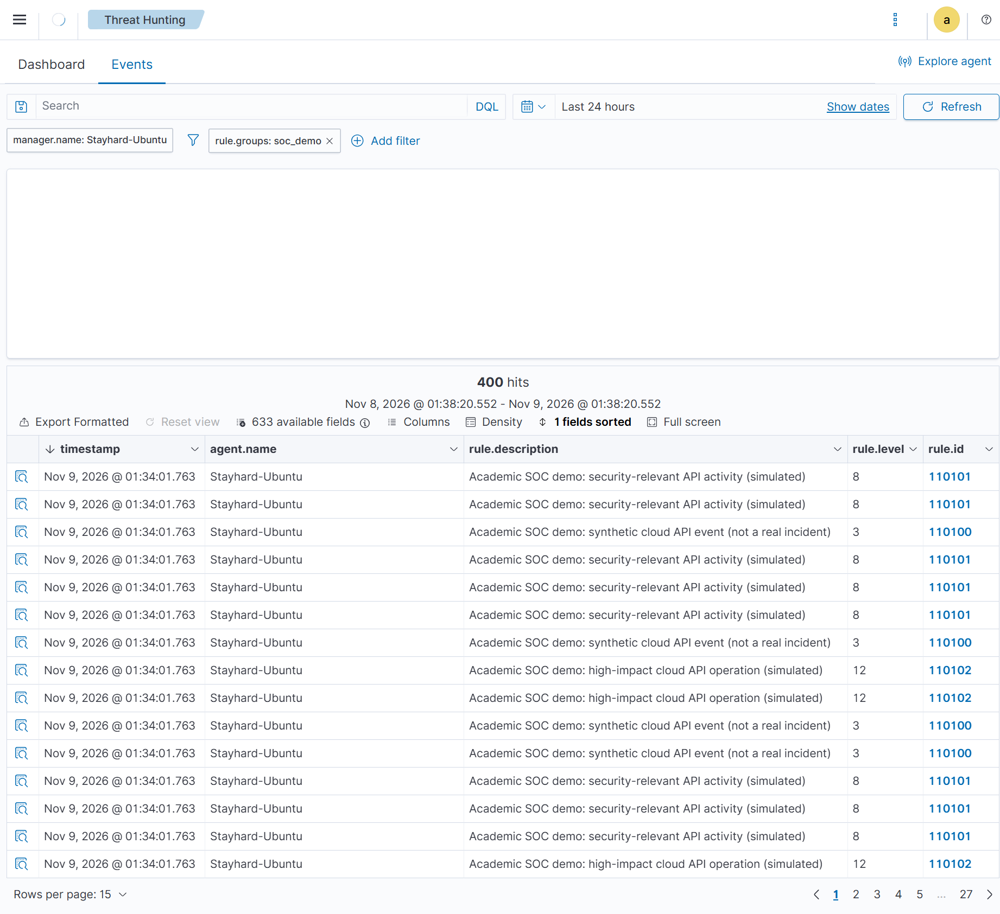
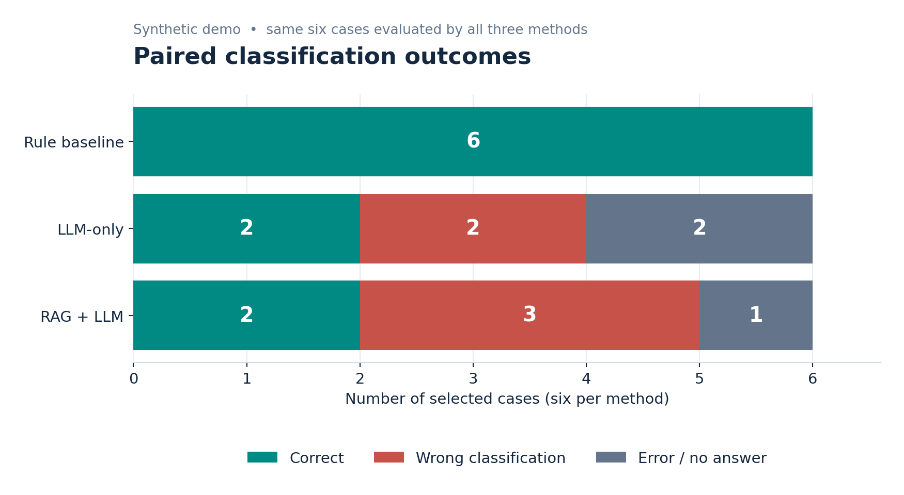

# Reproducible SOC demo — simulated cloud incidents

**Purpose:** Show a Wazuh → investigation (rules / LLM / RAG) → executive report → SOC cross-check path. **All 100 cases are synthetic test evidence; the code does not launch real attacks, access AWS, or alter external resources.** Original CloudTrail and Wazuh experiments stay unchanged.

## What is new

- `src/demo/soc_demo.py` — generates 100 deterministic cases (40 benign / 30 suspicious / 30 designated critical); 6-case paired **functional demo** (2 each); business-oriented Markdown report; joins actual Wazuh alert IDs to simulated source IDs.
- `deploy/wazuh/soc_demo_rules.xml` — optional manager rules, 110100–110102, for clearly tagged simulation events.
- `deploy/wazuh/ossec_localfile_snippet.xml` — optional monitored JSON log. Wazuh's JSON decoder is built in.
- `tests/test_soc_demo.py` — offline regression tests.

## Private data layout

`data/lab_evidence/soc_demo/` (Git-ignored): `cases.jsonl` (model-visible), `ground_truth_PRIVATE.jsonl` (labels), `wazuh_events.jsonl` (same IDs, Wazuh format), `manifest.json` (integrity hashes), `reports/`, `metrics_PRIVATE.json`, `executive_report.md`, `wazuh_crosscheck_PRIVATE.json`.

## Commands

```bash
python3 -m unittest discover -s tests -q
python3 -m src.demo.soc_demo prepare
python3 -m src.demo.soc_demo compare
```

`compare` runs baseline, local Qwen LLM-only and Qwen + retrieved references on the **same 6 cases** (12 model calls) and saves `executive_report.md`. To avoid overwriting previous evidence, use a new `--out` directory for a new run and copy prepared case/truth files if needed. Model responses are validated for valid IDs but not fully fact-checked. LLM run failures remain visible and count as failed outcomes.

## Wazuh dashboard integration (OPTIONAL; Ubuntu with Wazuh manager)

**Back up the live manager configuration; do not replace the full `ossec.conf`.** Do this in the demo VM, not production. Ensure the `localfile` block is inserted inside an existing `<ossec_config>` block. Example only:

```xml
<localfile>
  <location>/var/log/soc_demo_cloud.jsonl</location>
  <log_format>json</log_format>
</localfile>
```

1. `sudo cp /var/ossec/etc/ossec.conf /var/ossec/etc/ossec.conf.soc-demo.bak`
2. `sudo cp deploy/wazuh/soc_demo_rules.xml /var/ossec/etc/rules/soc_demo_rules.xml`
3. Insert the `localfile` block from `deploy/wazuh/ossec_localfile_snippet.xml` before the appropriate `</ossec_config>` end tag, preserving all existing configuration. Do not append it outside the XML structure.
4. `sudo touch /var/log/soc_demo_cloud.jsonl && sudo chmod 644 /var/log/soc_demo_cloud.jsonl`
5. Validate rules and test one synthetic JSON line with `sudo /var/ossec/bin/wazuh-logtest`; check `/var/ossec/logs/ossec.log` for errors before restarting manager.
6. After verifying configuration, `sudo systemctl restart wazuh-manager`.
7. Inject only generated synthetic lines: `sudo sh -c 'cat data/lab_evidence/soc_demo/wazuh_events.jsonl >> /var/log/soc_demo_cloud.jsonl'` (from project root). For a reliable absolute-path version: `sudo tee -a /var/log/soc_demo_cloud.jsonl < data/lab_evidence/soc_demo/wazuh_events.jsonl > /dev/null`.
8. In dashboard search `soc_demo: research_simulation` or `rule.groups: soc_demo` (field search varies by dashboard index mapping). Confirm alert details contain `sim_case_id` and `sim_event_id`.
9. Verify from Wazuh output: `sudo python3 -m src.demo.soc_demo crosscheck --alerts /var/ossec/logs/alerts/alerts.json` (make sure Python project is accessible when run with sudo). Optional export to private path instead of sudo if permissions require.

Wazuh **rules can detect/highlight simulated API events**; alert presence proves log ingestion and rule match, **not a real compromise or the correctness of AI**. The independent designed labels are in the private truth file. Comparison is against truth after investigation.

## Explain it to the professor

1. Open Wazuh and show `soc_demo` tagged alerts; optionally show real November Linux PAM alerts separately as a genuine event source.
2. Show one matched `sim_event_id` from Wazuh and in `cases.jsonl`.
3. Run the baseline, LLM-only, and RAG report paths for the same case; explain Qwen model is **not fine-tuned**.
4. Open `executive_report.md`: summaries, impact and next checks for nontechnical readers.
5. Explain `ground_truth_PRIVATE.jsonl` is isolated until scoring; discuss performance and citation limitations without overstating results.
6. Cite the earlier 6-case **real CloudTrail** comparison separately; do not mix its F1 values with synthetic demo outcomes.

**Limitations:** The synthetic distribution is deliberately engineered; SOC rules are designed around known simulation actions and may perform well for that reason. Six-case results do not estimate real-world accuracy. Wazuh monitoring is independent from the Python model, but not independent external ground truth. RAG retrieval can occur without final model citations; report that limitation.

### Optional safer Wazuh configuration helper

Instead of manually editing manager XML, you may use the included opt-in helper. It does not touch the running manager until `--apply`, backs up the original, validates rule syntax, and attempts rollback if validation/restart fails:

```bash
python3 deploy/wazuh/enable_demo.py
sudo python3 deploy/wazuh/enable_demo.py --apply
```

Once the manager is active, send the generated events into the monitored JSON log (this is the **only** injection action):

```bash
sudo tee -a /var/log/soc_demo_cloud.jsonl < data/lab_evidence/soc_demo/wazuh_events.jsonl > /dev/null
```

Run it only once; repeated injection creates duplicate alerts. Then inspect Wazuh Dashboard and `/var/ossec/logs/alerts/alerts.json` for the tagged events. This simulates incident **logs**, not attacks.

---

<!-- SOC-MILESTONE-2026-11-09-VERIFIED:START -->

## Executed Wazuh + AI demo — verified 9 November 2026

**The first integration and six-case model comparison have now run.** See the complete [visual evidence, quality audit and executive case study](soc_results_2026-11-09.md).



- Generated **100** academic cases (**40 benign / 30 suspicious / 30 designated critical**) and **400** distinct synthetic log entries. Wazuh's filtered Events view showed **400 hits**.
- Confirmed rule `110100`/level 3 (general), `110101`/level 8 (`GetObject`), and `110102`/level 12 (`StopLogging`). **Custom rule match ≠ confirmed attack.**
- `crosscheck --alerts /var/ossec/logs/alerts/alerts.json`: **397 of 400** generated event IDs matched; dashboard/file reconciliation remains open.
- On the **same six selected cases**, rule baseline classified 6/6 correctly; LLM-only 2/6 with 2 errors; RAG 2/6 with 1 error. These are *simulation-specific*, not deployment performance estimates.
- Private source reports: `data/lab_evidence/soc_demo/`; their free-text narrative is **not fully evidence-verified**, and the reviewed executive case study in the results document corrects specific model mistakes.
- Deployment incident: original conditions referring to `<field name="action" ...>` caused Wazuh to reject rule 110101; changed **two** conditions to `<action type="pcre2">`, validated and reapplied. Initial installer rollback restored manager availability. This is an **observed integration fix**, not a model result.
- **Do not rerun** the log injection command on the present VM: the 400 demo records were already observed in the dashboard. Duplicate injection changes experiment counts. Use the existing saved reports and dashboard for presentations.



<!-- SOC-MILESTONE-2026-11-09-VERIFIED:END -->
