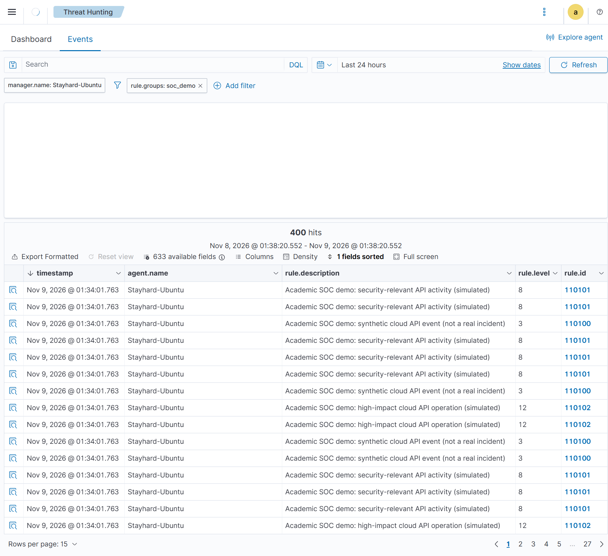
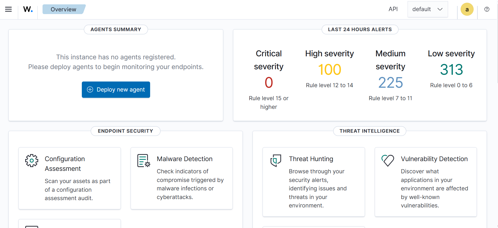
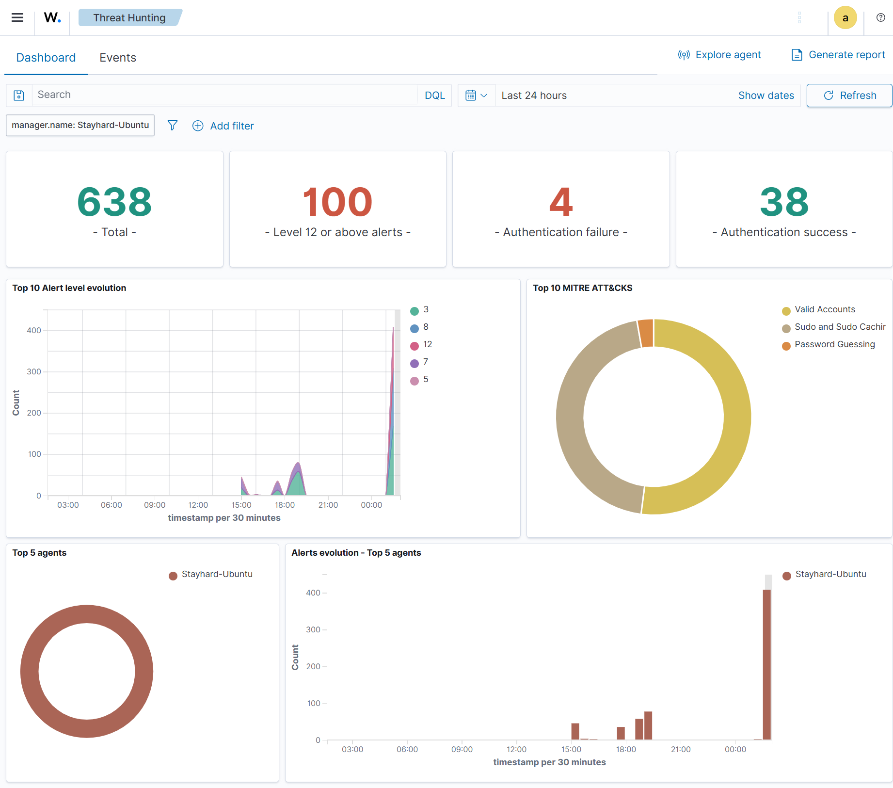
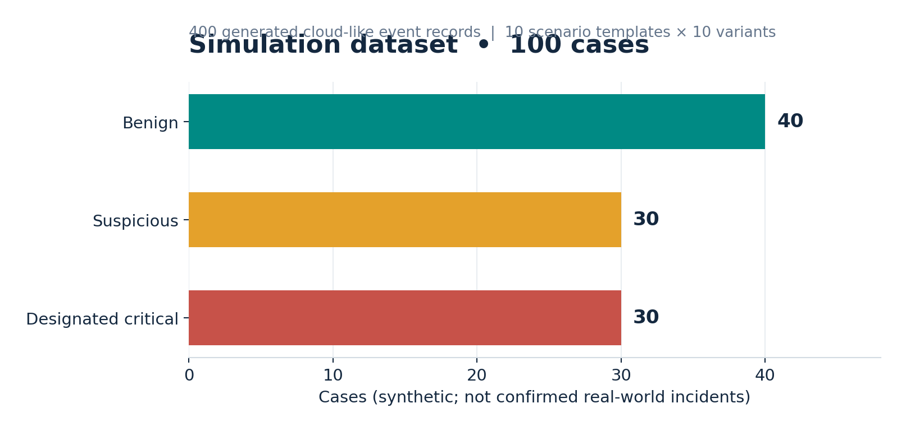
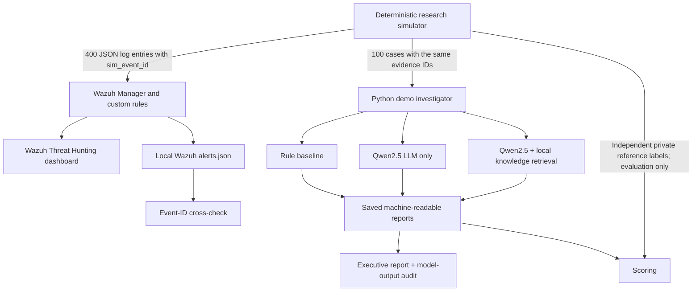
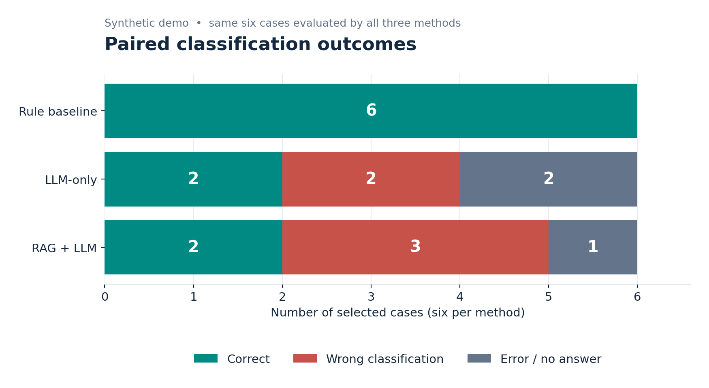
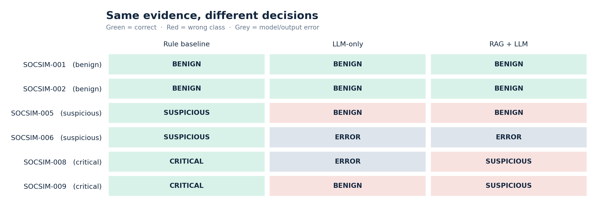
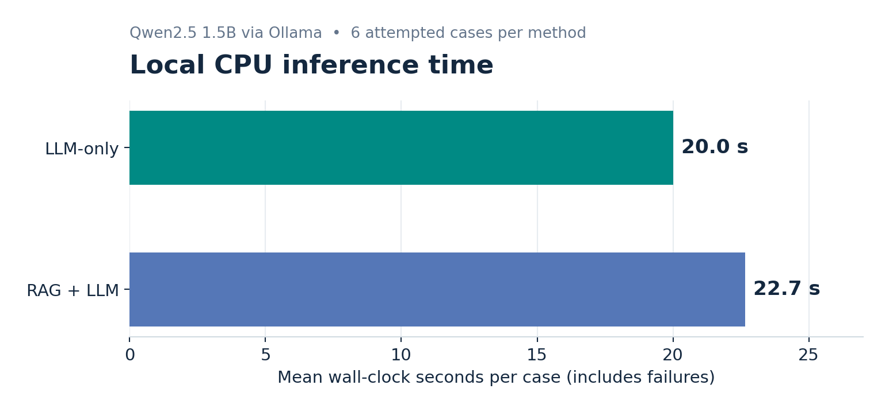

# SOC simulation and AI investigation — verified results (9 November 2026)

> **Project:** Evaluating AI-Assisted Cloud Security Incident Response · COMP 5112, Group 13  
> **Status:** Wazuh integration and six-case AI investigation **executed**. The research is still a prototype.  
> **Safety and provenance:** The 100 cases and 400 cloud-like log entries were **generated simulations**. No AWS API calls, external attacks, or live cloud compromises occurred. The Wazuh service and dashboard are real software processing those test records.

## At a glance

| Measure | Verified observation | What it proves (and what it does not) |
|---|---:|---|
| Synthetic cases | **100** (40 benign / 30 suspicious / 30 designated critical) | Prepared controlled scenarios, **not** 100 real incidents |
| Generated events | **400** | Input evidence with distinct synthetic event identifiers |
| Wazuh Threat Hunting filter `rule.groups: soc_demo` | **400 hits** | Indexed SOC demo events are visible in the screenshot; does not establish attack correctness |
| Local file cross-check | **397 / 400** = **99.25%** | 397 generated event identifiers matched the inspected local `alerts.json`; reason for the three-record discrepancy is **not yet proven** |
| Wazuh rules observed | **110100 (level 3), 110101 (level 8), 110102 (level 12)** | Three configured detection levels were validated using `wazuh-logtest` and appear in dashboard rows |
| AI comparison | **6 selected cases, 3 methods** | Functional paired demonstration, **not** representative performance evidence |
| LLM | **Qwen2.5 1.5B**, local via Ollama | Pretrained model, **not** fine-tuned for the project |
| Retrieval | **8 local knowledge-base entries available** | Prototype retrieval from curated notes; does not establish factual correctness |

### Visual evidence: Wazuh processing simulated events



**Figure 1.** User-captured Wazuh Threat Hunting **Events** page. The filters include `manager.name: Stayhard-Ubuntu` and `rule.groups: soc_demo`; the results show **400 hits** and individual rule IDs at levels 3, 8 and 12. These represent **event alerts**, not 400 confirmed attacks. Screenshots were captured from the Ubuntu VM's Wazuh environment and transferred from the Windows browser.

| Wazuh overview (all selected alerts) | Threat Hunting dashboard (all selected alerts) |
|---|---|
|  |  |

**Figure 2.** The general dashboard shows **638 total alerts** and **100 level-12-or-above alerts** during the selected period. Those totals include other local Linux monitoring and **must not** be equated to 100 simulated high-impact incidents. The filtered 400-hit screenshot is the correct evidence for the SOC simulation subset.

### Simulation dataset composition



The case labels are defined by the simulation generator, stored in `data/lab_evidence/soc_demo/ground_truth_PRIVATE.jsonl` and withheld from model inputs until scoring. The cases comprise repeated controlled scenario templates, so exact-match rules can perform unusually well.

## End-to-end system: what is and is not connected



**Integration boundary:** The current AI investigator processes the **same generated source evidence** that Wazuh monitors. It does **not** fetch alerts from the dashboard or automatically trigger investigations based on live Wazuh events. The `sim_case_id` and `sim_event_id` fields permit cross-checking without implying such automation. The Wazuh alert itself is a detector output, **not** independent truth that an attack happened.

## Results: exactly the same six selected simulated cases

The comparison selects two benign (`SOCSIM-001`, `002`), two suspicious (`005`, `006`) and two designated critical (`008`, `009`) cases. Each method is evaluated on this same subset; failed/incomplete model results remain failures rather than being silently excluded.



| Method | Correct out of 6 attempted | Incorrect classifications | Errors / no answer | Answered | Accuracy **among answered** |
|---|---:|---:|---:|---:|---:|
| Rule baseline | **6 / 6** | 0 | 0 | 6 | 100% |
| LLM-only | **2 / 6** | 2 | 2 | 4 | 50% |
| RAG + LLM | **2 / 6** | 3 | 1 | 5 | 40% |

**Interpretation:** Correct over all attempted cases was 100%, 33.3% and 33.3% respectively. **Do not** describe 50%/40% answered-only accuracy as overall accuracy; it excludes output failures. Baseline success is expected to be easier in a deterministic synthetic environment whose labels and rule conditions may share scenario assumptions. This experiment does **not** prove the baseline would outperform models on new real incidents.



| Case ID | Reference label | Baseline | LLM-only | RAG + LLM |
|---|---|---|---|---|
| SOCSIM-001 | benign | benign | benign | benign |
| SOCSIM-002 | benign | benign | benign | benign |
| SOCSIM-005 | suspicious | suspicious | **benign** | **benign** |
| SOCSIM-006 | suspicious | suspicious | **error** | **error** |
| SOCSIM-008 | critical | critical | **error** | **suspicious** |
| SOCSIM-009 | critical | critical | **benign** | **suspicious** |

**High-risk failure mode:** Neither AI arm correctly classified either designated-critical case. The LLM-only arm marked `SOCSIM-009` benign and returned an error for `SOCSIM-008`; RAG downgraded both to suspicious. This demonstrates the need for human review and protective deterministic controls in the prototype.

### Execution-time observations



| Method | Mean wall-clock time per attempted case | Included in mean |
|---|---:|---|
| Rule baseline | Printed as **0.0 seconds** at command precision | All 6 cases; **not** measured human analyst time |
| LLM-only | **20.01 seconds** | All 6 calls, including 2 errors |
| RAG + LLM | **22.65 seconds** | All 6 calls, including 1 error |

These timings come from the six case-level command outputs on local CPU hardware. They are neither controlled performance benchmarks nor evidence of improvements in **human analyst efficiency**.

## Quality audit: generated narrative is **not** ready to deliver to a client

The auto-generated private `data/lab_evidence/soc_demo/executive_report.md` provides a useful structured report, but its free-text interpretations include material factual errors. It must be treated as **unreviewed model output**. Evidence IDs appearing in a report only demonstrate a link to provided records, not that every prose claim follows from those records.

| Case | Source actions visible in the generated comparison | Problem observed in AI wording | Reviewed interpretation |
|---|---|---|---|
| `SOCSIM-002` | DescribeInstances; DescribeVolumes; DescribeSecurityGroups | Describes these **EC2** API operations as S3 bucket operations and asserts contextual details not established by the cited action list | Cloud infrastructure inventory/description API activity; no proven breach from actions alone |
| `SOCSIM-005` | Five ConsoleLogin events | Treats repeated failed login activity as benign / a single attempt | Suspicious authentication pattern requiring account owner review; does not prove compromise |
| `SOCSIM-006` | ListBuckets; GetBucketPolicy; GetBucketAcl; ListObjects | Both AI arms returned errors | Abstain from AI conclusion and escalate to manual review |
| `SOCSIM-008` | DescribeTrails; StopLogging; DeleteTrail | Incorrectly says an S3 bucket was deleted. `DeleteTrail` concerns an **AWS CloudTrail trail**, not an S3 bucket | Potential logging/audit-trail tampering **if these actions occurred in a real account**; here they were simulated |
| `SOCSIM-009` | ListPolicies; CreateAccessKey; AttachUserPolicy | Unfounded statement about brute force attempts and an S3 bucket | Potential identity/privilege-risk pattern in a real account; no evidence here of brute force or actual unauthorized access |

### Reviewed sample executive brief — SOCSIM-008 (simulation only)

**What we observed:** Three generated cloud API records, `SOCSIM-008-EVT-01` through `SOCSIM-008-EVT-03`, describe `DescribeTrails`, `StopLogging`, and `DeleteTrail`. The Wazuh custom rule flags `StopLogging` and `DeleteTrail` as high-impact simulated API operations (rule `110102`, level 12).

**Why a business leader should care:** If analogous activity were seen in a real AWS environment and was unauthorized, audit logging could be disrupted, making incident investigation and compliance verification harder. **No actual logging system was disabled in this demonstration.**

**What remains unknown:** Whether an equivalent real-world request would have succeeded, the actor's authorization, affected accounts, and any consequential loss of telemetry or business data. No real compromise or data loss is established by these synthetic records.

**Recommended analyst action (for a real alert):** Verify the identity and permissions of the actor, inspect relevant AWS CloudTrail configuration and management events, consult the cloud resource owner, and restore protective logging only through approved change/incident procedures.

**Confidence framing:** This is an evidence-based risk flag, **not** a confirmed attack determination. The AI output incorrectly described the resource deleted and therefore requires a human correction.

## Deployment, debugging and evidence trace

| Step | Observed result | Resolution / qualification |
|---|---|---|
| Prepared simulation | `PREPARED 100 synthetic cases, 400 simulated log events` | Private evidence stays Git-ignored |
| Initial config check | Ordinary Python process reported missing Wazuh config | `/var/ossec/etc/ossec.conf` exists; root access required |
| First `--apply` | Manager restart failed; installer rolled back; service recovered | Investigated `/var/ossec/logs/ossec.log` |
| Rule failure | `Field 'action' is static` for rule 110101 | Replaced two `<field name="action" ...>` conditions with valid `<action type="pcre2">` conditions |
| Validation / deployment | `wazuh-analysisd -t` and `wazuh-logcollector -t` passed; manager active | Corrected custom rules `110100`–`110102` installed |
| Unit `wazuh-logtest` | `GetObject` matched 110101/8; `StopLogging` matched 110102/12; general API activity matched 110100/3 | Rule-match verification, not compromise detection accuracy |
| Dashboard | Filtered `soc_demo` Events view displayed 400 hits | Screenshot above |
| Cross-check | `397` matching generated event IDs in inspected `alerts.json` | **3 missing from this file-based check; reason open** |
| Six-case comparison | Completed with 2 LLM-only errors and 1 RAG error | Model reliability/grounding failures documented; reruns are not assumed |

### Why do the dashboard and file cross-check differ?

The UI showed **400 indexed hits**, while a separate script found **397 generated IDs** in one local `alerts.json` file. Indexing, rotation, duplicate records or query windows are possibilities, **not findings**. Resolve by exporting all 400 filtered Wazuh documents and joining the exact `data.sim_event_id` values against `wazuh_events.jsonl`, and by checking local alert archive files. Do not claim 100% independently cross-checked coverage until those records are reconciled.

## Reproduction: commands and privacy

```bash
# Project root on the existing Ubuntu VM
python3 -m unittest discover -s tests -q
python3 -m src.demo.soc_demo prepare

# Requires working local Qwen2.5 via Ollama; avoid rerunning compare
# over an existing evidence folder without preserving the original reports.
python3 -m src.demo.soc_demo compare

# Verify the actual Wazuh alert file (requires manager and sudo):
sudo python3 -m src.demo.soc_demo crosscheck --alerts /var/ossec/logs/alerts/alerts.json

# Dashboard > Threat Hunting > Events, filter: rule.groups = soc_demo
```

**Do not repeat the event-injection command** on the current lab unless you first confirm how many entries are already present; repeating it will duplicate detection records. To demonstrate without changing data, open the filtered dashboard and saved private reports. For exact installation guidance see [the original SOC demo documentation](soc_demo.md).

**Private records:** `data/lab_evidence/soc_demo/` includes `cases.jsonl`, `wazuh_events.jsonl`, `ground_truth_PRIVATE.jsonl`, `metrics_PRIVATE.json`, `wazuh_crosscheck_PRIVATE.json`, individual report JSONs and `executive_report.md`. Keep these files outside version control, as configured. Only reviewed results, charts and redacted/non-sensitive screenshots are intended for GitHub.

## Separate research track: public CloudTrail development comparison

An earlier **different** six-case pilot used the Ariel Cyber **public, controlled CloudTrail development dataset**, not the 100-case synthetic Wazuh demo. Its reported binary attack-associated evaluation was: baseline **TP 1 / FP 0 / TN 3 / FN 2**, LLM-only **TP 3 / FP 3 / TN 0 / FN 0**, RAG **TP 1 / FP 1 / TN 2 / FN 2**; resulting F1 scores **0.50 / 0.667 / 0.40**, respectively, with the caveat that several model output-format issues were corrected before the successful comparison. This is **not the same classification task** as the synthetic **three-class severity** demo; do not merge the metrics or imply either pilot establishes deployment-grade accuracy. See [the separate CloudTrail comparison notes](three_method_comparison.md).

## Research conclusions and outstanding work

- **Completed:** Wazuh JSON log integration, three valid custom rule levels, filtered visual evidence, six-case paired investigation, private scoring, and a generated executive-report prototype.
- **Not completed:** Fully audited AI explanations; 100-case model evaluation; case-to-alert automatic triggering; independent real-world accuracy study; analyst-time measurement; 400-of-400 local archive reconciliation.
- **Preliminary finding:** A simple deterministic classifier matched all six engineered scenario labels; pretrained local LLM and RAG produced both misclassifications and malformed/failed responses. Retrieval alone did not ensure better grounding.
- **Safety:** Do not deploy these autonomous recommendations or use them to automatically remediate production systems. Analyst approval and claim-level checks are required.

**Evidence sources for this document:** Actual user-shared Ubuntu command output; actual Wazuh browser screenshots dated 9 November 2026; the generated report text and per-case comparisons, including noted hallucinations. No additional model runs were performed to create this documentation.
